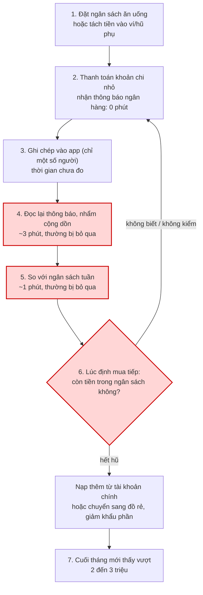
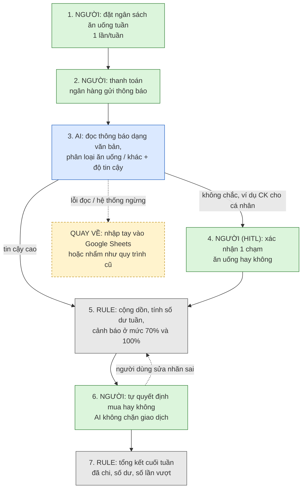

# Báo cáo nhóm — Day 02 Discovery & Problem Framing

> Bản chung của nhóm. Khi chốt bản cuối, **mỗi thành viên copy file này vào repo cá nhân**.
> Template chi tiết và prompt mẫu: [docs/01-worksheet.md](../../docs/01-worksheet.md). Bài mẫu: [docs/02-deliverable-example.md](../../docs/02-deliverable-example.md).

## 1. Thông tin nhóm

- Tên nhóm: nhom404
- Thành viên: xem `TEAM.md`
- Candidate problem được chọn (1 câu): Người dùng, đặc biệt là sinh viên và người trẻ tự quản lý tài chính, gặp khó khăn trong việc theo dõi các khoản chi tiêu ăn uống nhỏ lẻ nên không nắm được số tiền còn lại và dễ vượt ngân sách hàng tháng.
- Quyết định cuối: Not Yet

---

## 2. Hội tụ nhóm (CP3)

### 2.1. Pitch

| # | Người đưa ra | Candidate (Job Story ngắn) | Actor | Bottleneck | Câu hỏi phản biện (đặt ra khi pitch) |
|---:|---|---|---|---|---|
| 1 | Bùi Đức Tuấn | Khi kết thúc tuần học, tôi muốn tổng hợp lại kiến thức đã học để ôn tập nhanh và không bỏ sót nội dung quan trọng. | Sinh viên | Phải xem lại và tổng hợp bài học cũ, mất 1h30–2h/tuần. | Việc tổng hợp có thực sự giúp nhớ lâu hơn không, hay chỉ tạo bản tóm tắt mà ChatGPT đã làm được? |
| 2 | Bùi Đức Tuấn | Khi theo dõi chi tiêu ăn uống, tôi muốn biết tổng tiền đã chi và mức vượt ngân sách để điều chỉnh thói quen. | Cá nhân/sinh viên | Chi tiêu không được cộng dồn, đối chiếu thường xuyên; vượt 2–3 triệu/tháng trong 7 tháng liên tiếp. | Người dùng có sẵn sàng ghi từng khoản chi không? Vì sao không dùng ứng dụng quản lý chi tiêu hoặc bảng tính? |
| 3 | Bùi Đức Tuấn | Khi gặp lỗi trong quá trình làm lab, tôi muốn xác định và xử lý lỗi nhanh để tiếp tục hoàn thành bài. | Sinh viên làm lab | Chờ Discord khoảng 25 phút/lỗi, 3–4 lỗi/lab. | ChatGPT đã hỗ trợ debug được, vậy sản phẩm mới có thể truy cập dữ liệu hoặc môi trường nào mà chatbot thông thường không có? |
| 4 | Đinh Quốc Việt | Khi thực hiện bài lab có nhiều tài liệu hướng dẫn, tôi muốn đối chiếu và xác định đúng các yêu cầu bắt buộc để tránh làm thiếu hoặc sai deliverable. | Sinh viên làm lab | Đối chiếu 13 file Markdown, ước tính 1h30–2h/bài. | Nếu đưa toàn bộ tài liệu vào ChatGPT để tổng hợp thì sản phẩm mới còn tạo thêm giá trị gì? |
| 5 | Đinh Quốc Việt | Khi vận hành Agent NPC có nhiều thành phần, tôi muốn kiểm tra trạng thái và phát hiện sai lệch để xác định sự cố nhanh hơn. | Developer/người vận hành Agent NPC | Phải đối chiếu `/diagnostics`, `/status`, PID, module và source; HTTP 200 chưa chứng minh luồng hoạt động đúng. | Tại sao không dùng health check, logging và monitoring thông thường? Lợi thế nằm ở khả năng phát hiện lỗi nào? |
| 6 | Đinh Quốc Việt | Khi cập nhật repository, tôi muốn kiểm tra branch, remote và thay đổi file chính xác trước khi commit/push để tránh thao tác nhầm. | Developer/sinh viên lập trình | Phải kiểm tra thủ công Git state, mất 8–12 phút/lần. | Tại sao không dùng GitHub Desktop, Git alias hoặc script tự động thay vì xây một sản phẩm AI? |
| 7 | Nguyễn Mạnh Cường | Khi có bài tập và deadline từ nhiều môn, tôi muốn tập trung các nhiệm vụ vào một nơi để không bỏ sót hạn nộp. | Sinh viên | Thông tin phân tán ở LMS, email, nhóm chat và thông báo; mất 10–15 phút/ngày. | Calendar và task manager đã giải quyết được chưa? Sản phẩm mới có tự lấy và cập nhật deadline không? |
| 8 | Nguyễn Mạnh Cường | Khi di chuyển vào giờ cao điểm, tôi muốn lựa chọn lộ trình phù hợp để giảm thời gian và tránh tình trạng giao thông bất lợi. | Sinh viên/người đi làm | Dữ liệu giao thông biến động, thời gian dự kiến trên bản đồ có thể không chính xác. | Google Maps đã có dữ liệu giao thông và đề xuất tuyến đường, vậy sản phẩm mới có lợi thế dữ liệu nào? |
| 9 | Nguyễn Mạnh Cường | Khi mua và lưu trữ thực phẩm, tôi muốn theo dõi số lượng và hạn sử dụng để hạn chế thực phẩm bị quên, mua trùng hoặc hết hạn. | Hộ gia đình/người quản lý mua sắm | Thông tin không tập trung, khó theo dõi thực phẩm đang có; mất 10–15 phút/ngày. | Người dùng có thực sự lãng phí thực phẩm đủ nhiều để cần ứng dụng riêng không? Ai sẽ nhập dữ liệu và có sẵn sàng trả tiền không? |

### 2.2. Cluster

| Cluster | Các candidate | Pattern chung |
|---|---|---|
| A — Quản lý thông tin và công việc cá nhân | #1 Tổng hợp bài học; #4 Tổng hợp yêu cầu lab; #7 Quản lý deadline | Thông tin phân tán ở nhiều nguồn, người dùng phải tự đọc, lọc, đối chiếu và chuyển thành công việc hoặc kiến thức có cấu trúc. |
| B — Theo dõi và kiểm soát nguồn lực | #2 Ngân sách ăn uống; #9 Quản lý thực phẩm; #8 Lựa chọn lộ trình | Người dùng cần theo dõi trạng thái thay đổi theo thời gian và đưa ra quyết định nhằm giảm lãng phí, chi phí hoặc thời gian. |
| C — Chẩn đoán và xử lý vấn đề kỹ thuật | #3 Kẹt lỗi lab; #5 Kiểm tra trạng thái Agent NPC; #6 Quản lý thay đổi GitHub | Người dùng phải kiểm tra nhiều thông tin hoặc thành phần, xác định nguyên nhân sai lệch và lựa chọn hành động tiếp theo. |

### 2.3. Opportunity Solution Tree rút gọn

Gốc là **1 outcome**. Nhánh là **opportunity** (nhu cầu, pain), không phải tính năng hay công cụ.

```text
OUTCOME: Giảm tình trạng vượt ngân sách ăn uống hằng tháng từ 2–3 triệu đồng xuống 0, đồng thời giúp người dùng kiểm soát số dư ngân sách tuần trong vòng 30 giây.
├── Opportunity A: Người dùng không nắm được số tiền còn lại trong ngân sách ăn uống vì các khoản chi nhỏ phát sinh liên tục và khó ghi nhớ tổng chi tiêu.
├── Opportunity B: Người dùng thường bỏ qua việc cộng dồn và đối chiếu chi tiêu với ngân sách tuần 500.000–1.000.000 đồng, đặc biệt khi bận hoặc chi tiêu gấp.
└── Opportunity C:  Người dùng chỉ nhận ra ngân sách đã bị vượt vào cuối tháng, khi không còn nhiều khả năng điều chỉnh thói quen chi tiêu.
```

Những ý đã gạch bỏ vì là solution đội lốt opportunity:

-Tạo ứng dụng quản lý ngân sách ăn uống.
-Tự động cộng dồn các khoản chi tiêu.
-Gửi thông báo khi đã sử dụng 70% ngân sách.
-Tạo dashboard hiển thị số dư ngân sách tuần.
-Sử dụng AI để phân tích và đưa ra lời khuyên chi tiêu.
-Kết nối TPBank, MoMo hoặc tài khoản ngân hàng để đồng bộ giao dịch.

### 2.4. Chấm điểm shortlist (1–5)


| Candidate | Actor rõ | Quy trình rõ | Pain có bằng chứng | Impact đo được | Vừa sức lab | So sánh được No AI/Rule/Workflow/Agent | Nhóm hiểu domain | Tổng |
|---|---:|---:|---:|---:|---:|---:|---:|---:|
| **#2 — Quản lý chi tiêu** | 5 | 5 | 5 | 5 | 5 | 5 | 4 | **34/35** |
| **#5 — Kiểm tra trạng thái Agent NPC** | 5 | 5 | 4 | 4 | 3 | 5 | 3 | **29/35** |
| **#7 — Quản lý deadline học tập** | 5 | 4 | 2 | 4 | 4 | 5 | 3 | **27/35** |

**Candidate được chọn:** #2 — Quản lý chi tiêu: Người tiêu dùng, đặc biệt là sinh viên và người trẻ tự quản lý tài chính cá nhân, thường phát sinh nhiều khoản chi nhỏ cho đồ ăn vặt và ăn ngoài. Do thiếu công cụ theo dõi và đối chiếu chi tiêu thường xuyên với ngân sách, họ khó nhận biết tốc độ tiêu tiền và có nguy cơ vượt ngân sách ăn uống hằng tháng.

**Vì sao chọn:** Có nhóm người dùng tiềm năng là sinh viên và người trẻ tự quản lý tài chính, nhu cầu kiểm soát chi tiêu thiết thực, pain có bằng chứng ban đầu và impact đo lường được. Bài toán cũng phù hợp triển khai MVP trong thời gian lab.

**Vì sao loại các candidate còn lại:** #5 — Agent NPC diagnostics có thị trường ngách, hướng đến nhóm nhà phát triển và vận hành hệ thống AI. #7 — Quản lý deadline học tập có nhiều giải pháp thay thế như Calendar và task manager, chưa chứng minh được lợi thế cạnh tranh rõ ràng.

**Xử lý bất đồng (nếu có):** Nhóm ưu tiên #2 vì vấn đề có đối tượng người dùng tương đối rộng, nhu cầu kiểm soát chi tiêu thiết thực và kết quả có thể đo lường.

---

## 3. Kiểm chứng + research giải pháp đã có (CP4)

> Phần CP4 dưới đây được tổng hợp từ ghi chú nhóm cung cấp về vấn đề kiểm soát chi tiêu ăn vặt. Hai cuộc phỏng vấn là dữ liệu tự thuật do nhóm ghi nhận, chưa đủ để đại diện cho toàn bộ sinh viên/người đi làm. Ngày và hình thức phỏng vấn cụ thể chưa được ghi lại.

### 3.1. Assumption Map

| # | Giả định | Loại (Value / Usability / Feasibility / Viability) | Quan trọng (1–5) | Đã có bằng chứng (1–5) | Kiểm chứng trước? |
|---:|---|---|---:|---:|---|
| 1 | Người gặp khó khăn với chi tiêu sẽ sẵn sàng trả tiền cho công cụ giúp kiểm soát chi tiêu. | Viability | 5 | 1 | Có — ghi chú hiện chưa xác nhận hành vi trả phí; một người nói rõ chưa từng trả phí cho ứng dụng quản lý tài chính. Cần hỏi thêm người đúng phân khúc và kiểm tra hành vi chi trả thực tế. |
| 2 | Cảnh báo khi đã dùng 70% ngân sách tuần có thể ngăn quyết định mua ăn vặt ngay tại quầy. | Value / Usability | 5 | 1 | Có — một người kể đã nạp thêm tiền tại quầy khi đi cùng đồng nghiệp; chưa thử cảnh báo 70%, nên đây là tín hiệu phản bác gián tiếp chứ chưa phải phép thử trực tiếp. |
| 3 | Ngân sách theo tháng phản hồi quá chậm để điều chỉnh hành vi chi tiêu trong tuần. | Value | 4 | 2 | Có — ghi nhận đây là nhận định sơ bộ; hai cuộc phỏng vấn chưa kiểm tra trực tiếp so sánh chu kỳ tuần/tháng. |
| 4 | Cách theo dõi thủ công có ma sát, còn tài khoản/hũ phụ có thể dễ dàng nạp thêm nên khó duy trì giới hạn. | Usability / Value | 4 | 2 | Có — một người kể đã bỏ ứng dụng ghi chép sau bốn ngày vì quên nhập một khoản; một người kể đã nạp thêm tiền từ tài khoản khác. Cần kiểm chứng với thêm người dùng và cách làm khác. |
| 5 | Khi hết ngân sách ăn vặt, người dùng không có lựa chọn thay thế phù hợp và có thể tiếp tục chi tiêu bằng tín dụng. | Value | 2 | 1 | Chưa — đây là giả định ít quan trọng hơn, chưa có bằng chứng trong hai cuộc phỏng vấn; không suy rộng từ ghi chú hiện có. |

Điểm quan trọng/bằng chứng là đánh giá sơ bộ của nhóm theo thang 1–5. Mức bằng chứng thấp phản ánh dữ liệu hiện có chủ yếu là hai lời kể, không phải kết quả định lượng hay kiểm chứng đại diện.

**Giả định nhóm ưu tiên kiểm chứng:** (1) mức sẵn sàng trả tiền và (2) cảnh báo có ảnh hưởng tới quyết định mua tại thời điểm phát sinh hay không. Hai cuộc phỏng vấn tạo tín hiệu phản bác ban đầu; chưa đủ để kết luận chắc chắn về toàn bộ phân khúc.

### 3.2. Kiểm chứng

**Cách đã dùng:** Hai phỏng vấn chớp nhoáng theo ghi chú nhóm cung cấp, tập trung vào hành vi chi tiêu và cách từng thử quản lý tiền. Ngày, kênh và thời lượng phỏng vấn chưa được ghi nhận. Không có survey/log định lượng.

Interview snapshot (mỗi buổi phỏng vấn một bảng, hoặc đặt file trong `report/assets/cp4-interview-snapshot-N.md`):

#### Interview Snapshot #1

| Trường | Nội dung |
|---|---|
| Người được hỏi (vai trò, không ghi tên thật) | Nhân viên văn phòng (ẩn danh; tên riêng và tuổi được lược bỏ). |
| Câu nói đáng nhớ nhất (nguyên văn theo ghi chú) | “Lúc đó đang đi cùng đồng nghiệp.” |
| Lần gần nhất gặp vấn đề này: chuyện gì đã xảy ra? | Theo lời kể, người được hỏi chuyển 1,5 triệu đồng vào MoMo đầu tháng để dành cho ăn vặt. Khi tiền hết vào tuần thứ ba, người này nạp thêm 500.000 đồng từ MBBank tại quầy khi đang đi cùng đồng nghiệp. Không có số liệu chi tiêu cả tuần vì người này không biết chính xác đã chi bao nhiêu. |
| Hiện đang xử lý bằng cách nào (workaround)? | Chuyển trước một khoản vào ví điện tử phụ; khi khoản đó hết thì có thể nạp thêm từ tài khoản ngân hàng. |
| Mất bao lâu, bao lần? | Một lần nạp thêm được nêu trong câu chuyện về tuần thứ ba; thời gian thao tác và tần suất chi tiêu chưa được ghi lại. |
| Insight / opportunity rút ra | Tài khoản tách riêng không nhất thiết tạo giới hạn khó vượt qua. Bối cảnh xã hội có thể ảnh hưởng đến quyết định chi tiêu; cần hỏi thêm về nhiều lần mua và kiểm tra trực tiếp tác động của cảnh báo, không khẳng định cảnh báo chắc chắn thất bại. |

#### Interview Snapshot #2

| Trường | Nội dung |
|---|---|
| Người được hỏi (vai trò, không ghi tên thật) | Sinh viên năm cuối (ẩn danh; tên riêng và tuổi được lược bỏ). |
| Câu nói đáng nhớ nhất (nguyên văn theo ghi chú) | “Quên nhập 1 ly nước mía xong số dư bị lệch, nản quá bỏ luôn.” |
| Lần gần nhất gặp vấn đề này: chuyện gì đã xảy ra? | Theo lời kể, người được hỏi bị thiếu tiền tiêu vặt vào tháng trước. Trước đó đã tải ứng dụng Sổ Thu Chi (MISA), nhưng bỏ sau bốn ngày khi quên ghi một khoản mua nước mía và số dư theo dõi bị lệch. |
| Hiện đang xử lý bằng cách nào (workaround)? | Đã thử ghi chép bằng ứng dụng; hiện không có cách theo dõi ổn định nào được ghi nhận. |
| Mất bao lâu, bao lần? | Duy trì ứng dụng được bốn ngày; thời gian ghi mỗi giao dịch và tần suất thiếu tiền chưa được ghi lại. |
| Insight / opportunity rút ra | Bỏ sót một giao dịch nhỏ có thể làm người dùng mất tin tưởng vào số dư theo dõi. Đây là tín hiệu về ma sát ghi chép; một cuộc phỏng vấn chưa đủ để kết luận người dùng nói chung không chấp nhận trả phí. |

Tổng hợp:

| Nguồn | Số người / số mẫu | Tín hiệu xác nhận | Tín hiệu phản bác |
|---|---:|---|---|
| Phỏng vấn chớp nhoáng theo ghi chú nhóm | 2 người (1 nhân viên văn phòng, 1 sinh viên năm cuối) | Có ví dụ về một người bỏ ghi chép sau bốn ngày và một người nạp thêm tiền khi khoản để riêng đã hết; cho thấy các cách tự theo dõi/tách tiền có thể có ma sát hoặc bị vượt qua trong những trường hợp này. | Một người nói rõ chưa từng trả phí cho ứng dụng quản lý tài chính; một trường hợp có yếu tố đi cùng đồng nghiệp khi mua. Chưa phỏng vấn đủ để kết luận về willingness-to-pay hoặc hiệu quả cảnh báo 70%. |

**Nhóm đã sửa problem thế nào sau kiểm chứng:**

Nhóm chuyển trọng tâm giả thuyết từ “cộng dồn và so ngân sách” sang khó khăn khi duy trì giới hạn chi tiêu tại thời điểm phát sinh: ghi chép có thể bị bỏ dở, khoản tách riêng có thể được nạp thêm, và bối cảnh xã hội có thể ảnh hưởng quyết định mua. Kết quả hiện tại **chưa chứng minh** hard-limit, khóa giao dịch theo MCC hay commitment contract là giải pháp phù hợp. Đây là các hướng cần kiểm chứng riêng; cần đánh giá tính khả thi, quyền kiểm soát của người dùng, rủi ro tài chính và phương án thoát/hoàn tiền trước khi đề xuất thử nghiệm. Không thu phí trực tiếp là giả thuyết kinh doanh mới, chưa được xác nhận bởi mẫu phỏng vấn này.

### 3.3. Research giải pháp đã có

| Công cụ / case / pattern | Link | Giải bước nào trong quy trình? | Điểm mạnh | Khoảng trống / rủi ro | Bài học cho nhóm |
|---|---|---|---|---|---|
| YNAB — lập kế hoạch ngân sách | [YNAB](https://www.ynab.com/) | Hỗ trợ lập kế hoạch phân bổ tiền trước khi chi tiêu; có thể tham khảo cho bước đặt ngân sách theo nhóm mục tiêu. | Cách tiếp cận lập kế hoạch trước khi chi giúp người dùng chủ động phân bổ tiền. | Trang chính thức đã mở không đủ căn cứ cho nhận định cụ thể về màu cảnh báo, độ phức tạp khi đối soát hay khả năng đồng bộ với ngân hàng Việt Nam; cần kiểm tra tài liệu/tính năng cụ thể trước khi khẳng định. | Công cụ lập ngân sách không tự chứng minh rằng người dùng sẽ tuân thủ giới hạn tại quầy; nhóm cần kiểm tra hành vi và sự phù hợp với bối cảnh Việt Nam. |
| Money Lover — ghi chép và quản lý ngân sách | [Money Lover (trang tiếng Việt)](https://moneylover.me/vi) | Ghi nhận/phân loại thu chi, theo dõi ngân sách và xem báo cáo; trang giới thiệu nêu có nhập giao dịch thủ công và tự động. | Bao phủ bước ghi nhận và theo dõi chi tiêu; có thể dùng làm giải pháp sẵn có để so sánh thay vì tự xây lại. | Tài liệu trang giới thiệu không chứng minh ứng dụng chặn giao dịch tại quầy hay cảnh báo trước khi giao dịch. Nhận định về quét SMS và cảnh báo sau khi quẹt thẻ chưa được xác minh độc lập. | Phân biệt “biết ngân sách/chi tiêu” với “ngăn được giao dịch”; kiểm tra xem nhu cầu thật nằm ở theo dõi hay kiểm soát hành vi. |
| Timo — Hũ Chi Tiêu | [Timo](https://timo.vn/) | Chia tiền theo hũ và hỗ trợ quản lý tài chính cá nhân; có thể tham khảo cho bước phân bổ khoản chi. | Trang chính thức giới thiệu tính năng Hũ Chi Tiêu và công cụ quản lý tài chính trong ứng dụng. | Trang đã kiểm tra không đủ căn cứ cho khẳng định thẻ chỉ chi được từ một hũ, người dùng có thể nạp lại trong một thao tác, hoặc hũ tạo hard-limit. Cần xác minh điều kiện và luồng thao tác thực tế. | Không gọi cách chia hũ là “giới hạn cứng” nếu chưa kiểm tra quyền chuyển tiền và cơ chế thanh toán. |
| Beeminder — commitment contract (pattern tham khảo) | [Beeminder](https://www.beeminder.com/) | Theo dõi mục tiêu định lượng; trang chính thức mô tả có thể tính phí khi người dùng vượt đường mục tiêu. | Cho thấy một pattern cam kết có hậu quả tài chính khi không đạt mục tiêu đã đặt. | Chưa chứng minh pattern này phù hợp cho ngân sách ăn uống, có thể chấp nhận với người thu nhập hạn chế, hay tiền phạt được chuyển từ thiện. Cần kiểm tra điều khoản và thử nghiệm mức độ chấp nhận/rủi ro trước khi cân nhắc. | Commitment contract chỉ là giả thuyết để nghiên cứu thêm, không phải kết luận monetization. Cần bảo vệ quyền tự chủ, minh bạch cơ chế phạt và tránh làm trầm trọng thiếu hụt tài chính. |

---

## 4. Quy trình trước/sau (CP5)

### 4.1. Quy trình hiện tại

Sơ đồ (ASCII, Mermaid hoặc link ảnh trong `report/assets/`):



Ô đỏ là bottleneck. Thời gian lấy từ Card #2 của Tuấn (tự ước); các bước của người khác lấy từ Interview Snapshot #1 và #2 ở mục 3.2.

| Bước | Actor | Input | Output | Thời gian / tần suất | Ghi chú |
|---:|---|---|---|---|---|
| 1 | Người dùng | Thu nhập; mức ngân sách ăn uống (Tuấn: 500k đến 1 triệu/tuần; PV1: 1,5 triệu/tháng cho ăn vặt) | Ngân sách đã đặt, hoặc tiền đã tách sang ví/hũ phụ (PV1: chuyển vào MoMo) | Đầu tuần hoặc đầu tháng; thời gian chưa đo | Tách tiền không tạo giới hạn cứng: PV1 vẫn nạp thêm được |
| 2 | Người dùng; ngân hàng/ví | Khoản chi ăn vặt, ăn ngoài | Giao dịch + thông báo ngân hàng | Nhiều lần/ngày; 0 phút thêm | Tuấn: gần như 100% là chuyển khoản |
| 3 | Người dùng (chỉ một số người) | Từng khoản chi | Bản ghi trong app ghi chép | Mỗi khoản; thời gian/khoản chưa đo | PV2 dùng Sổ Thu Chi (MISA), bỏ sau 4 ngày vì quên 1 khoản và số dư bị lệch |
| 4 | Người dùng | Các thông báo ngân hàng trong tuần | Tổng đã chi (nhẩm) | ~3 phút/lần, "thỉnh thoảng" | Bước hay bị bỏ qua nhất |
| 5 | Người dùng | Tổng đã chi + ngân sách tuần | Biết còn bao nhiêu | ~1 phút/lần | Chỉ xảy ra nếu đã làm bước 4 |
| 6 | Người dùng | Ý định mua tiếp, bối cảnh (đi cùng đồng nghiệp, bạn bè) | Mua tiếp, nạp thêm, hoặc cắt khẩu phần | Tại quầy, vài giây | PV1: hết tiền tuần 3, nạp thêm 500.000 đ từ MBBank tại quầy khi đi cùng đồng nghiệp |
| 7 | Người dùng | Sao kê, số dư cuối tháng | Phát hiện vượt ngân sách | Cuối tháng | Tuấn: vượt 2 đến 3 triệu/tháng, 7 tháng liên tiếp; PV2: thiếu tiền tiêu vặt tháng trước |

**Bottleneck chính:** Bước 4 đến 6. Khi làm thì chỉ mất khoảng 4 phút, nhưng bước 4 và 5 thường bị bỏ qua, nên ở bước 6 (lúc quyết định mua hoặc nạp thêm) người dùng không biết mình còn bao nhiêu trong ngân sách. Vì vậy bottleneck được đo bằng **số lần không kiểm tra trước khi chi** và **số tiền nạp thêm vượt ngân sách**, không đo bằng phút.

### 4.2. Quy trình tương lai

Ghi rõ bước nào **Rule**, bước nào **AI**, bước nào **con người**, **boundary** ở đâu, **phương án quay về** khi AI sai.



Xanh dương là AI, xám là Rule, xanh lá là con người, vàng là phương án quay về.

**Boundary (AI không được làm):**
- Không chuyển tiền, không chặn hay huỷ giao dịch, không tự nạp hay rút tiền giữa các tài khoản.
- Không tự đổi mức ngân sách người dùng đã đặt.
- Không đưa lời khuyên đầu tư, vay hay tín dụng.
- Không gửi nội dung giao dịch ra ngoài cho bên thứ ba.

**Khi nào cần con người (HITL):**
- Khoản AI không chắc là ăn uống (chuyển khoản cho cá nhân, tên người bán lạ): người dùng xác nhận trước khi cộng vào ngân sách.
- Mọi quyết định mua, nạp thêm hay đổi ngân sách đều do người dùng.

**Phương án quay về:**
- AI phân loại sai: người dùng sửa nhãn, Rule tính lại số dư ngay.
- Không đọc được thông báo hoặc hệ thống ngừng: quay về nhập tay vào Google Sheets hoặc nhẩm như cũ.
- Chi bằng tiền mặt: nhắc cuối ngày "hôm nay bạn có chi tiền mặt cho ăn uống không" để nhập tay.

### 4.3. Before / after

| Chỉ số | Trước | Sau (kỳ vọng) | Ghi chú |
|---|---:|---:|---|
| Số bước | 7 | 7 | Số bước giữ nguyên; thay đổi nằm ở ai làm bước nào |
| Tổng thời gian để biết số dư tuần | ~4 phút/lần (nhẩm 3' + so 1'), thường bị bỏ qua | Dưới 30 giây/lần | "Sau" là mục tiêu, chưa đo; "Trước" là Tuấn tự ước |
| Số bước thủ công | 6 (bước 1 đến 6) | 4 (bước 1, 2, 4, 6) | Bước 4 chỉ xảy ra với khoản AI không chắc |
| Bottleneck chính | Không biết số dư lúc quyết định mua hoặc nạp thêm | Quyết định mua vẫn ở người dùng; bối cảnh xã hội (PV1) có thể vẫn làm vượt ngân sách | Bottleneck có thể chuyển từ "thiếu thông tin" sang "hành vi" |
| Rủi ro mới phát sinh | Chưa có | Phân loại sai làm lệch số dư và người dùng mất tin tưởng (giống PV2 bỏ app sau 4 ngày); cảnh báo gây phiền nên bị tắt; cần quyền đọc thông báo; dữ liệu tài chính nhạy cảm; người dùng nhiều tài khoản | Các rủi ro này được chấm lại ở mục 8 |

---

## 5. Problem Statement v0 (CP5)

| Trường | Nội dung |
|---|---|
| **Actor** | Người trẻ tự quản lý chi tiêu ăn uống (sinh viên, nhân viên văn phòng mới đi làm), có nhiều khoản chi nhỏ cho ăn vặt và ăn ngoài, tự đặt ngân sách theo tuần hoặc tháng và thanh toán chủ yếu bằng chuyển khoản hoặc ví điện tử |
| **Quy trình** | Đặt ngân sách hoặc tách tiền sang ví phụ; thanh toán nhiều lần/ngày và nhận thông báo ngân hàng; thỉnh thoảng nhẩm cộng dồn (~3') và so với ngân sách tuần (~1'); khi hết thì nạp thêm từ tài khoản chính hoặc cắt khẩu phần; cuối tháng mới biết đã vượt (chi tiết ở mục 4.1) |
| **Bottleneck** | Bước cộng dồn và đối chiếu với ngân sách thường bị bỏ qua, ghi chép tay bị bỏ dở khi lệch một khoản, nên tại thời điểm quyết định mua hoặc nạp thêm, người dùng không biết mình còn bao nhiêu trong ngân sách |
| **Impact** | Tuấn vượt ngân sách ăn uống 2 đến 3 triệu/tháng, 7 tháng liên tiếp, cuối tháng phải giảm đồ ăn lành mạnh và chuyển sang đồ rẻ. PV1 nạp thêm 500.000 đ ngoài khoản 1,5 triệu đã tách (vượt khoảng 33%). PV2 thiếu tiền tiêu vặt tháng trước và bỏ cách ghi chép sau 4 ngày |
| **Success Metric** (baseline → target, cách đo) | (1) Số tiền vượt ngân sách ăn uống/tháng: baseline 2 đến 3 triệu (Tuấn) → target 0. (2) Thời gian để biết số dư ngân sách tuần: baseline ~4 phút và thường không làm → target dưới 30 giây. (3) Số lần chi mà không biết số dư trước đó: baseline chưa đo → đo trong tuần đầu pilot. Cách đo: đối chiếu sao kê ngân hàng/ví mỗi tuần trong 4 tuần pilot; người tham gia tự bấm giờ khi xem số dư |
| **Boundary** (AI không được làm gì; khi nào cần con người kiểm tra, HITL) | AI không được chuyển tiền, chặn hay huỷ giao dịch, tự đổi ngân sách, đưa lời khuyên đầu tư hay vay, hoặc chia sẻ dữ liệu giao dịch ra ngoài. Con người kiểm tra khi một khoản không rõ có phải ăn uống không, và mọi quyết định mua hay nạp thêm đều do người dùng |

Phản biện nhận được (từ AI hoặc nhóm khác) và nhóm có đồng ý không:

- **Từ nhóm (bảng pitch, mục 2.1):** "Người dùng có sẵn sàng ghi từng khoản chi không? Vì sao không dùng ứng dụng quản lý chi tiêu hoặc bảng tính?" Đồng ý đây là điểm yếu: PV2 bỏ ghi tay sau 4 ngày. Vì vậy v0 đặt bottleneck vào việc không biết số dư lúc quyết định chi, không phải vào việc thiếu chỗ ghi. Việc so với Money Lover, Timo và bảng tính được làm ở mục 3.3.
- **Từ AI (Claude, phản biện theo rubric):** baseline (1) chỉ có số của một người (Tuấn); target 0 có thể quá chặt; và PV1 cho thấy người dùng có thể đã biết hết tiền mà vẫn nạp thêm, nên "không biết số dư" có thể không phải nguyên nhân duy nhất. Nhóm đồng ý cả ba điểm: chưa đổi v0, nhưng đưa vào mục 7 và mục 8 (rủi ro Value) và vào kế hoạch kiểm chứng.

---

## 6. Mức can thiệp AI (CP6)

### 6.1. Ma trận độ mơ hồ × độ phức tạp

Bài của nhóm nằm ở ô: Độ mơ hồ trung bình–cao, độ phức tạp thấp–trung bình.

Vì sao: Bài toán có độ mơ hồ trung bình–cao do nội dung giao dịch đôi khi không rõ ràng, nhưng độ phức tạp thấp–trung bình vì quy trình xử lý tương đối cố định. Vì vậy, AI chỉ hỗ trợ phân loại giao dịch; Rule xử lý tính toán và người dùng đưa ra quyết định, không cần Agent.

### 6.2. So sánh 4 mức

| Mức | Phương án cho bài của nhóm | Đủ khi nào | Rủi ro | Chọn? |
|---|---|---|---|---|
| **No AI** | Người dùng tự ghi khoản chi vào Google Sheets hoặc ứng dụng quản lý chi tiêu. | Giao dịch ít, người dùng duy trì được thói quen ghi chép. | Dễ quên hoặc bỏ ghi chép; PV2 đã bỏ ghi tay sau 4 ngày. | Không chọn làm phương án chính |
| **Rule** | Dùng từ khóa hoặc mẫu nội dung để phân loại giao dịch; tự cộng dồn và cảnh báo theo ngưỡng. | Nội dung giao dịch rõ ràng, quy tắc phân loại ổn định. | Khó xử lý tên người bán lạ hoặc nội dung chuyển khoản không rõ. | Dùng cho bước tính toán và cảnh báo |
| **Workflow** | Nhận thông báo → AI phân loại và đánh giá độ tin cậy → người dùng xác nhận khi cần → Rule tính số dư và cảnh báo. | Quy trình cố định nhưng có một số giao dịch cần hiểu ngữ cảnh. | AI phân loại sai, người dùng phải xác nhận hoặc sửa nhãn. | **Chọn** |
| **Agent** | AI tự theo dõi chi tiêu, tự tìm dữ liệu, đề xuất hoặc thực hiện hành động kiểm soát ngân sách. | Khi cần xử lý nhiều tình huống chưa xác định trước và có đủ cơ chế kiểm soát. | Quá phức tạp, tăng quyền truy cập và rủi ro tài chính; không cần thiết với bài toán hiện tại. | Không chọn |

**Mức chọn:** Workflow có AI hỗ trợ phân loại giao dịch.

**Vì sao không chọn mức đơn giản hơn:** No AI phụ thuộc vào việc người dùng tự ghi chép, trong khi phỏng vấn cho thấy có người đã bỏ ghi tay sau 4 ngày. Rule có thể xử lý cộng dồn, tính số dư và cảnh báo nhưng khó phân loại các giao dịch có nội dung không rõ ràng. Vì vậy, nhóm chọn Workflow để AI hỗ trợ ở bước phân loại, còn Rule đảm nhiệm các phép tính và con người kiểm soát quyết định cuối cùng.

### 6.3. AI Canvas rút gọn

| Thành phần | Nội dung |
|---|---|
| **Prediction — AI dự đoán / tạo ra gì?** | Phân loại nội dung thông báo giao dịch thành ăn uống hoặc không phải ăn uống, kèm độ tin cậy của kết quả. |
| **Judgment — Con người cân nhắc, quyết định gì?** | Xác nhận hoặc sửa nhãn đối với giao dịch AI không chắc chắn; tự đánh giá số dư và quyết định có tiếp tục chi tiêu hay không. |
| **Action — Hành động cuối cùng là gì, ai làm?** | Rule tự cộng dồn chi tiêu, tính số dư và tạo cảnh báo. Người dùng quyết định mua tiếp, dừng chi hoặc điều chỉnh ngân sách. |
| **Outcome — Đo kết quả bằng gì?** | Số lần không kiểm tra ngân sách trước khi chi; số lần nạp thêm tiền; số tiền vượt ngân sách ăn uống mỗi tháng; tỷ lệ phân loại giao dịch chính xác. |
| **Input — AI cần dữ liệu đầu vào gì mỗi lần chạy? Có sẵn không?** | Nội dung thông báo giao dịch dạng văn bản, số tiền, thời gian và danh mục chi tiêu do người dùng xác nhận. Thông báo chỉ có sẵn nếu người dùng cấp quyền và hệ thống nhận được; giao dịch tiền mặt cần nhập thủ công. |
| **Feedback — Lấy phản hồi ở đâu để cải thiện?** | Nhãn người dùng xác nhận hoặc sửa, các giao dịch bị phân loại sai và dữ liệu chi tiêu được đối chiếu cuối tuần. |

### 6.4. Hai câu hỏi của Google PAIR

- Người dùng muốn **được hỗ trợ (augment)** hay **giao hẳn việc (automate)**? Bằng chứng: Nhóm chọn Augment. AI chỉ hỗ trợ phân loại giao dịch và cảnh báo ngân sách; người dùng vẫn xác nhận giao dịch không rõ ràng và tự quyết định việc chi tiêu. Điều này phù hợp với CP4, khi người dùng vẫn muốn chủ động kiểm soát tiền của mình.
- AI sai kiểu nào tệ hơn, **báo nhầm** hay **bỏ sót**? Vì sao, và thiết kế đã xử lý thế nào: Bỏ sót giao dịch ăn uống nguy hiểm hơn vì khiến số dư hiển thị cao hơn thực tế, dẫn đến nguy cơ chi vượt ngân sách. Nhóm xử lý bằng cách cho phép người dùng nhập thủ công, xác nhận giao dịch AI không chắc chắn và sửa nhãn để Rule tính lại số dư. Báo nhầm cũng được hạn chế bằng cơ chế xác nhận trước khi ghi nhận giao dịch có độ tin cậy thấp.

---

## 7. Problem Statement v1 + tiêu chí đánh giá (CP6)

| Trường | Nội dung |
|---|---|
| **Actor** | Như v0, giới hạn ở người thanh toán chủ yếu bằng chuyển khoản hoặc ví điện tử (gần như 100% với Tuấn), vì bước AI cần đọc được thông báo giao dịch |
| **Quy trình** | Như v0 (mục 4.1); quy trình tương lai ở mục 4.2 |
| **Bottleneck** | Như v0: tại thời điểm quyết định mua hoặc nạp thêm, người dùng không biết mình còn bao nhiêu trong ngân sách ăn uống tuần |
| **Impact** | Như v0 |
| **Success Metric** (baseline → target, cách đo) | (1) Số tiền vượt ngân sách ăn uống/tháng: 2 đến 3 triệu → 0. (2) Thời gian biết số dư tuần: ~4 phút → dưới 30 giây. (3) Thêm cho bước AI: tỉ lệ thông báo được phân loại đúng "ăn uống / khác" ≥ 90%, đo bằng cách người tham gia gắn nhãn tay để đối chiếu trong tuần đầu. (4) Thêm: tỉ lệ khoản người dùng phải sửa nhãn ≤ 10%. Cách đo như v0: sao kê hằng tuần trong 4 tuần pilot |
| **Boundary** | Như v0, thêm: AI chỉ đọc nội dung thông báo để phân loại, không lưu số tài khoản, không tự cộng khoản không chắc vào ngân sách khi chưa được người dùng xác nhận |
| **AI intervention point** | Bước 3 của quy trình tương lai (mục 4.2): đọc thông báo ngân hàng dạng văn bản tự do và phân loại khoản đó có phải ăn uống không, kèm độ tin cậy. Cộng dồn và cảnh báo là Rule, không dùng AI |
| **Mức chọn** | Workflow (các bước định sẵn, AI làm một bước phân loại) |
| **Rủi ro & người kiểm tra** | Phân loại sai làm lệch số dư: người dùng xác nhận khoản không chắc và sửa nhãn. Cảnh báo không đổi được hành vi (PV1): nhóm đo số lần vẫn chi sau cảnh báo trong pilot. Lộ dữ liệu tài chính: không lưu số tài khoản, không gửi dữ liệu ra ngoài; nhóm kiểm tra log mỗi tuần pilot |

**Thay đổi so với v0 và lý do:**

| Trường | v0 | v1 | Vì sao đổi |
|---|---|---|---|
| Actor | Người thanh toán bằng chuyển khoản hoặc ví điện tử (mô tả chung) | Giới hạn rõ ở người thanh toán chủ yếu bằng chuyển khoản | Bước AI chỉ đọc được giao dịch có thông báo; tiền mặt chuyển sang nhắc nhập tay |
| Success Metric | 3 chỉ số về tiền và thời gian | Thêm chỉ số độ chính xác phân loại (≥ 90%) và tỉ lệ sửa nhãn (≤ 10%) | Khi đã chọn có bước AI, phải đo riêng chất lượng bước đó; PV2 cho thấy chỉ một khoản lệch cũng làm người dùng bỏ cuộc |
| Boundary | Cấm chuyển tiền, chặn giao dịch, đổi ngân sách, khuyên tài chính, chia sẻ dữ liệu | Thêm: không lưu số tài khoản, không tự cộng khoản không chắc khi chưa xác nhận | Bước AI tạo thêm rủi ro dữ liệu và rủi ro phân loại sai |
| AI intervention point, Mức chọn, Rủi ro & người kiểm tra | Chưa có | Bước 3 (phân loại thông báo); Workflow; người dùng xác nhận + nhóm kiểm log | Trường mới của v1 sau khi chọn mức can thiệp ở CP6 |

**Tiêu chí đánh giá đầu ra của AI (3–5 tiêu chí):**

| # | Tiêu chí | Đạt khi | Không đạt khi |
|---:|---|---|---|
| 1 | | | |
| 2 | | | |
| 3 | | | |

---

## 8. Quyết định (CP6)

### 8.1. Bốn rủi ro

| Rủi ro | Câu hỏi | Mức độ rủi ro (Thấp = an toàn / TB / Cao = nguy hiểm) | Lý do / bằng chứng |
|---|---|---|---|
| **Value** | Người dùng có thật sự cần và sẽ dùng không? | **Cao** | Pain có thật (Tuấn vượt 2 đến 3 triệu/tháng trong 7 tháng; PV1 nạp thêm 500k; PV2 thiếu tiền). Nhưng PV1 biết đã hết tiền mà vẫn nạp thêm khi đi cùng đồng nghiệp, nên chưa chứng minh được biết số dư sớm hơn sẽ làm người dùng chi ít đi. Mới có 2 cuộc phỏng vấn; giả định trả phí (assumption #1) có bằng chứng 1/5, và một người nói chưa từng trả phí cho app tài chính |
| **Usability** | Người dùng có dùng được, có hiểu và sửa được đầu ra của AI không? | **TB** | Bỏ được việc ghi tay (lý do PV2 bỏ app), và người dùng chỉ cần xác nhận khoản không chắc. Nhưng nếu phân loại sai mà không được sửa kịp, số dư lệch và người dùng mất tin tưởng như PV2. Cảnh báo quá nhiều có thể bị tắt |
| **Feasibility** | Có đủ dữ liệu, công cụ, kỹ năng để làm không? | **TB** | Thông báo ngân hàng là văn bản có sẵn trên điện thoại; phân loại văn bản ngắn là việc LLM làm được. Nhưng nhóm chưa kiểm tra định dạng thông báo của từng ngân hàng, chưa kiểm tra quyền đọc thông báo trên điện thoại, và người dùng có thể chi ở nhiều tài khoản |
| **Viability** | Có hợp chi phí, pháp lý, quy định tổ chức không? Ai vận hành? | **TB** | Đã có Money Lover (ghi nhận, ngân sách), Timo (Hũ Chi Tiêu), TPBank và MoMo (thống kê theo tháng), nên phải chứng minh được phần hơn (cảnh báo theo tuần ngay lúc chi). Dữ liệu giao dịch là dữ liệu nhạy cảm. Mô hình thu tiền chưa được kiểm chứng; nhóm sinh viên không có quyền tích hợp vào app ngân hàng |

### 8.2. Kết luận

**Quyết định:** Not Yet

**Lý do:** Rủi ro Value đang ở mức Cao nhưng kiểm chứng được nhanh và rẻ, không cần xây AI trước. Hai câu cần trả lời trước khi xây: (1) người dùng có thật sự chi ít đi khi biết số dư tuần ngay lúc chi không, hay vẫn nạp thêm như PV1; (2) tool có sẵn (Money Lover, Timo, app ngân hàng) đã làm được bao nhiêu phần việc này.

**Nếu Go, pilot nhỏ nhất:** Không áp dụng ở thời điểm này.

**Nếu Not Yet, cần kiểm chứng gì trước:**
1. Phỏng vấn thêm ít nhất 3 người theo The Mom Test, hỏi về lần gần nhất họ nạp thêm tiền hoặc chi vượt ngân sách ăn uống, và khi đó họ có biết số dư không.
2. Thử 2 tuần với 5 người, không dùng AI: mỗi người nhập khoản chi ăn uống vào Google Sheets có sẵn công thức cộng dồn và báo khi dùng hết 70% ngân sách tuần. Đo: số tiền vượt ngân sách, số lần vẫn chi sau khi đã thấy cảnh báo, số ngày duy trì nhập liệu.
3. Kiểm tra trực tiếp Money Lover, Timo, TPBank, MoMo xem có cảnh báo ngân sách theo tuần không, và mỗi tool bỏ trống bước nào.
4. Thu 20 thông báo giao dịch thật (đã che số tài khoản) để xem phân loại "ăn uống / khác" khó đến mức nào.

**Nếu No-Go, nên làm gì thay AI:** Dùng tool có sẵn (Money Lover hoặc hũ Timo) cùng một Rule đơn giản do người dùng tự đặt, ví dụ Google Sheets có công thức cảnh báo 70%.

**Ngưỡng dừng** (nếu sau … mà … thì quay về …): Nếu sau 2 tuần thử bằng Google Sheets và cảnh báo 70%, từ 3/5 người trở lên vẫn vượt ngân sách tuần dù đã thấy cảnh báo, hoặc từ 3/5 người trở lên bỏ nhập liệu trước ngày thứ 7, thì không xây bước AI phân loại và quay về dùng tool có sẵn + Rule. Nếu ít nhất 3/5 người giữ được ngân sách và lý do bỏ cuộc chủ yếu là phải nhập tay, thì chuyển sang Go với pilot có bước AI phân loại thông báo.

---

## 9. Hạn chế và hướng tiếp theo

**Hạn chế:**

- Kiểm chứng mới có 2 cuộc phỏng vấn chớp nhoáng (1 nhân viên văn phòng, 1 sinh viên năm cuối), là lời tự kể, chưa ghi ngày, kênh và thời lượng. Chưa có survey hay số liệu định lượng.
- Baseline về số tiền vượt ngân sách (2 đến 3 triệu/tháng) và thời gian tự kiểm tra (~4 phút) chỉ đến từ một người (Tuấn), là số tự ước, chưa đối chiếu bằng sao kê.
- Chưa kiểm chứng người dùng có sẵn sàng trả phí không (assumption #1, mức bằng chứng 1/5).
- Chưa thử trực tiếp cảnh báo khi dùng hết 70% ngân sách có làm người dùng chi ít đi không. PV1 là tín hiệu phản bác gián tiếp: biết đã hết tiền nhưng vẫn nạp thêm.
- Chưa kiểm tra định dạng thông báo của từng ngân hàng, quyền đọc thông báo trên điện thoại, và trường hợp người dùng chi ở nhiều tài khoản.
- Phần research mới dựa trên trang giới thiệu chính thức của Money Lover, Timo, YNAB, Beeminder; chưa dùng thử để xác nhận tính năng cụ thể (mục 3.3).
- Các ngưỡng ở mục 7 và 8 (phân loại đúng ≥ 90%, sửa nhãn ≤ 10%, ngưỡng dừng 3/5 người) là đề xuất của nhóm, chưa có căn cứ thực nghiệm.

**Hướng tiếp theo:** làm theo kế hoạch kiểm chứng ở mục 8.2: phỏng vấn thêm ít nhất 3 người theo The Mom Test; thử 2 tuần với 5 người bằng Google Sheets có cảnh báo 70% (không dùng AI); kiểm tra trực tiếp các tool có sẵn; thu 20 thông báo giao dịch thật (đã che số tài khoản) để đánh giá độ khó của bước phân loại. Sau đó dùng ngưỡng dừng ở mục 8.2 để quyết định Go hoặc No-Go.

## 10. Tài liệu tham khảo

**Công cụ và case đã research (mục 3.3):**

- YNAB: https://www.ynab.com/
- Money Lover: https://moneylover.me/vi
- Timo (Hũ Chi Tiêu): https://timo.vn/
- Beeminder: https://www.beeminder.com/

**Framework dùng trong bài:**

- Design Council, Framework for Innovation (Double Diamond): https://www.designcouncil.org.uk/resources/framework-for-innovation/
- Intercom, How we accidentally invented Job Stories: https://www.intercom.com/blog/accidentally-invented-job-stories/
- Teresa Torres, Opportunity Solution Trees: https://www.producttalk.org/opportunity-solution-trees/
- Teresa Torres, The Interview Snapshot: https://www.producttalk.org/interview-snapshot/
- David Bland, Assumptions Mapping (Strategyzer): https://www.strategyzer.com/library/how-assumptions-mapping-can-focus-your-teams-on-running-experiments-that-matter
- Rob Fitzpatrick, The Mom Test: https://www.momtestbook.com/
- Jeff Gothelf, Business Problem Statement (Lean UX): https://jeffgothelf.com/blog/business-problem-statement-opportunity-statement/
- Google PAIR, People + AI Guidebook, User Needs: https://pair.withgoogle.com/chapter/user-needs/
- Anthropic, Building effective agents: https://www.anthropic.com/research/building-effective-agents
- Agrawal, Gans, Goldfarb, A Simple Tool to Start Making Decisions with the Help of AI (AI Canvas, HBR): https://hbr.org/2018/04/a-simple-tool-to-start-making-decisions-with-the-help-of-ai
- Marty Cagan, The Four Big Risks (SVPG): https://www.svpg.com/four-big-risks/

**Tài liệu lab:** [docs/01-worksheet.md](../../docs/01-worksheet.md), [docs/02-deliverable-example.md](../../docs/02-deliverable-example.md), [docs/03-international-frameworks.md](../../docs/03-international-frameworks.md)
