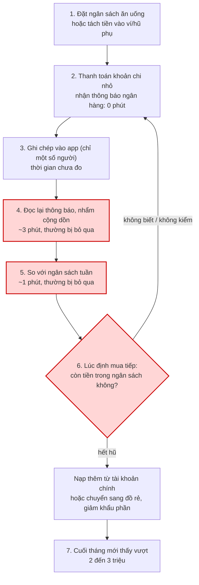
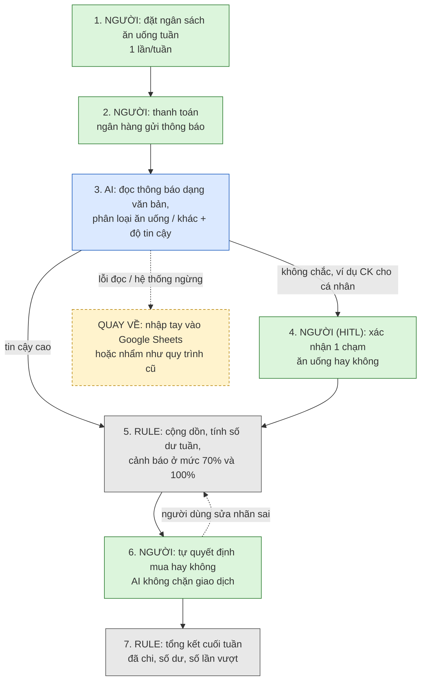

# Báo cáo nhóm — Day 02 Discovery & Problem Framing

> Bản chung của nhóm, viết trên repo do nhóm trưởng fork. Không copy file này sang repo cá nhân.
> Template chi tiết và prompt mẫu: [docs/01-worksheet.md](../../docs/01-worksheet.md). Bài mẫu: [docs/02-deliverable-example.md](../../docs/02-deliverable-example.md).

## 1. Thông tin nhóm

- Tên nhóm:
- Thành viên: xem `TEAM.md`
- Candidate problem được chọn (1 câu):
- Quyết định cuối: Go / Not Yet / No-Go

---

## 2. Hội tụ nhóm (CP3)

### 2.1. Pitch

| # | Người đưa ra | Candidate (Job Story ngắn) | Actor | Bottleneck | Câu hỏi phản biện nhận được (ai hỏi) |
|---:|---|---|---|---|---|
| 1 | | | | | |
| 2 | | | | | |
| 3 | | | | | |
| 4 | | | | | |
| 5 | | | | | |
| 6 | | | | | |
| 7 | | | | | |
| 8 | | | | | |
| 9 | | | | | |
| 10 | | | | | |
| 11 | | | | | |
| 12 | | | | | |

### 2.2. Cluster

| Cluster | Các candidate | Pattern chung |
|---|---|---|
| A | | |
| B | | |
| C | | |

### 2.3. Opportunity Solution Tree rút gọn

Gốc là **1 outcome**. Nhánh là **opportunity** (nhu cầu, pain), không phải tính năng hay công cụ.

```text
OUTCOME: 
├── Opportunity A: 
├── Opportunity B: 
└── Opportunity C: 
```

Những ý đã gạch bỏ vì là solution đội lốt opportunity:

-

### 2.4. Chấm điểm shortlist (1–5)

| Candidate | Actor rõ | Quy trình rõ | Pain có bằng chứng | Impact đo được | Vừa sức lab | So sánh được No AI/Rule/Workflow/Agent | Nhóm hiểu domain | Tổng |
|---|---:|---:|---:|---:|---:|---:|---:|---:|
| | | | | | | | | |
| | | | | | | | | |
| | | | | | | | | |

**Candidate được chọn:**

**Vì sao chọn:**

**Vì sao loại các candidate còn lại:**

**Xử lý bất đồng (nếu có):**

---

## 3. Kiểm chứng + research giải pháp đã có (CP4)

### 3.1. Assumption Map

| # | Giả định | Loại (Value / Usability / Feasibility / Viability) | Quan trọng (1–5) | Đã có bằng chứng (1–5) | Kiểm chứng trước? |
|---:|---|---|---:|---:|---|
| 1 | | | | | |
| 2 | | | | | |
| 3 | | | | | |
| 4 | | | | | |
| 5 | | | | | |
| 6 | | | | | |

*Điền 4–6 giả định; xóa dòng thừa.*

Giả định nhóm kiểm chứng trong buổi này:

### 3.2. Kiểm chứng

Cách đã dùng: Phỏng vấn / Survey / Log, ticket, review

Interview snapshot (mỗi buổi phỏng vấn một bảng, hoặc đặt file trong `report/assets/cp4-interview-snapshot-N.md`):

| Trường | Nội dung |
|---|---|
| Người được hỏi (vai trò, không ghi tên thật) | |
| Câu nói đáng nhớ nhất (nguyên văn) | |
| Lần gần nhất gặp vấn đề này: chuyện gì đã xảy ra? | |
| Hiện đang xử lý bằng cách nào (workaround)? | |
| Mất bao lâu, bao lần? | |
| Insight / opportunity rút ra | |

Tổng hợp:

| Nguồn | Số người / số mẫu | Tín hiệu xác nhận | Tín hiệu phản bác |
|---|---:|---|---|
| | | | |

**Nhóm đã sửa problem thế nào sau kiểm chứng:**

### 3.3. Research giải pháp đã có

| Công cụ / case / pattern | Link | Giải bước nào trong quy trình? | Điểm mạnh | Khoảng trống / rủi ro | Bài học cho nhóm |
|---|---|---|---|---|---|
| | | | | | |
| | | | | | |
| | | | | | |

---

## 4. Quy trình trước/sau (CP5)

### 4.1. Quy trình hiện tại

Sơ đồ (ASCII, Mermaid hoặc link ảnh trong `report/assets/`):



Ô đỏ là bottleneck. Thời gian lấy từ Card #2 của Tuấn (tự ước); các bước của người khác lấy từ Interview Snapshot #1 và #2 ở mục 3.2.

| Bước | Actor | Input | Output | Thời gian / tần suất | Ghi chú |
|---:|---|---|---|---|---|
| 1 | Người dùng | Thu nhập; mức ngân sách ăn uống (Tuấn: 500k đến 1 triệu/tuần; PV1: 1,5 triệu/tháng cho ăn vặt) | Ngân sách đã đặt, hoặc tiền đã tách sang ví/hũ phụ (PV1: chuyển vào MoMo) | Đầu tuần hoặc đầu tháng; thời gian chưa đo | Tách tiền không tạo giới hạn cứng: PV1 vẫn nạp thêm được |
| 2 | Người dùng; ngân hàng/ví | Khoản chi ăn vặt, ăn ngoài | Giao dịch + thông báo ngân hàng | Nhiều lần/ngày; 0 phút thêm | Tuấn: gần như 100% là chuyển khoản |
| 3 | Người dùng (chỉ một số người) | Từng khoản chi | Bản ghi trong app ghi chép | Mỗi khoản; thời gian/khoản chưa đo | PV2 dùng Sổ Thu Chi (MISA), bỏ sau 4 ngày vì quên 1 khoản và số dư bị lệch |
| 4 | Người dùng | Các thông báo ngân hàng trong tuần | Tổng đã chi (nhẩm) | ~3 phút/lần, "thỉnh thoảng" | Bước hay bị bỏ qua nhất |
| 5 | Người dùng | Tổng đã chi + ngân sách tuần | Biết còn bao nhiêu | ~1 phút/lần | Chỉ xảy ra nếu đã làm bước 4 |
| 6 | Người dùng | Ý định mua tiếp, bối cảnh (đi cùng đồng nghiệp, bạn bè) | Mua tiếp, nạp thêm, hoặc cắt khẩu phần | Tại quầy, vài giây | PV1: hết tiền tuần 3, nạp thêm 500.000 đ từ MBBank tại quầy khi đi cùng đồng nghiệp |
| 7 | Người dùng | Sao kê, số dư cuối tháng | Phát hiện vượt ngân sách | Cuối tháng | Tuấn: vượt 2 đến 3 triệu/tháng, 7 tháng liên tiếp; PV2: thiếu tiền tiêu vặt tháng trước |

**Bottleneck chính:** Bước 4 đến 6. Khi làm thì chỉ mất khoảng 4 phút, nhưng bước 4 và 5 thường bị bỏ qua, nên ở bước 6 (lúc quyết định mua hoặc nạp thêm) người dùng không biết mình còn bao nhiêu trong ngân sách. Vì vậy bottleneck được đo bằng **số lần không kiểm tra trước khi chi** và **số tiền nạp thêm vượt ngân sách**, không đo bằng phút.

### 4.2. Quy trình tương lai

Ghi rõ bước nào **Rule**, bước nào **AI**, bước nào **con người**, **boundary** ở đâu, **phương án quay về** khi AI sai.



Xanh dương là AI, xám là Rule, xanh lá là con người, vàng là phương án quay về.

**Boundary (AI không được làm):**
- Không chuyển tiền, không chặn hay huỷ giao dịch, không tự nạp hay rút tiền giữa các tài khoản.
- Không tự đổi mức ngân sách người dùng đã đặt.
- Không đưa lời khuyên đầu tư, vay hay tín dụng.
- Không gửi nội dung giao dịch ra ngoài cho bên thứ ba.

**Khi nào cần con người (HITL):**
- Khoản AI không chắc là ăn uống (chuyển khoản cho cá nhân, tên người bán lạ): người dùng xác nhận trước khi cộng vào ngân sách.
- Mọi quyết định mua, nạp thêm hay đổi ngân sách đều do người dùng.

**Phương án quay về:**
- AI phân loại sai: người dùng sửa nhãn, Rule tính lại số dư ngay.
- Không đọc được thông báo hoặc hệ thống ngừng: quay về nhập tay vào Google Sheets hoặc nhẩm như cũ.
- Chi bằng tiền mặt: nhắc cuối ngày "hôm nay bạn có chi tiền mặt cho ăn uống không" để nhập tay.

### 4.3. Before / after

| Chỉ số | Trước | Sau (kỳ vọng) | Ghi chú |
|---|---:|---:|---|
| Số bước | 7 | 7 | Số bước giữ nguyên; thay đổi nằm ở ai làm bước nào |
| Tổng thời gian để biết số dư tuần | ~4 phút/lần (nhẩm 3' + so 1'), thường bị bỏ qua | Dưới 30 giây/lần | "Sau" là mục tiêu, chưa đo; "Trước" là Tuấn tự ước |
| Số bước thủ công | 6 (bước 1 đến 6) | 4 (bước 1, 2, 4, 6) | Bước 4 chỉ xảy ra với khoản AI không chắc |
| Bottleneck chính | Không biết số dư lúc quyết định mua hoặc nạp thêm | Quyết định mua vẫn ở người dùng; bối cảnh xã hội (PV1) có thể vẫn làm vượt ngân sách | Bottleneck có thể chuyển từ "thiếu thông tin" sang "hành vi" |
| Rủi ro mới phát sinh | Chưa có | Phân loại sai làm lệch số dư và người dùng mất tin tưởng (giống PV2 bỏ app sau 4 ngày); cảnh báo gây phiền nên bị tắt; cần quyền đọc thông báo; dữ liệu tài chính nhạy cảm; người dùng nhiều tài khoản | Các rủi ro này được chấm lại ở mục 8 |

---

## 5. Problem Statement v0 (CP5)

| Trường | Nội dung |
|---|---|
| **Actor** | Người trẻ tự quản lý chi tiêu ăn uống (sinh viên, nhân viên văn phòng mới đi làm), có nhiều khoản chi nhỏ cho ăn vặt và ăn ngoài, tự đặt ngân sách theo tuần hoặc tháng và thanh toán chủ yếu bằng chuyển khoản hoặc ví điện tử |
| **Quy trình** | Đặt ngân sách hoặc tách tiền sang ví phụ; thanh toán nhiều lần/ngày và nhận thông báo ngân hàng; thỉnh thoảng nhẩm cộng dồn (~3') và so với ngân sách tuần (~1'); khi hết thì nạp thêm từ tài khoản chính hoặc cắt khẩu phần; cuối tháng mới biết đã vượt (chi tiết ở mục 4.1) |
| **Bottleneck** | Bước cộng dồn và đối chiếu với ngân sách thường bị bỏ qua, ghi chép tay bị bỏ dở khi lệch một khoản, nên tại thời điểm quyết định mua hoặc nạp thêm, người dùng không biết mình còn bao nhiêu trong ngân sách |
| **Impact** | Tuấn vượt ngân sách ăn uống 2 đến 3 triệu/tháng, 7 tháng liên tiếp, cuối tháng phải giảm đồ ăn lành mạnh và chuyển sang đồ rẻ. PV1 nạp thêm 500.000 đ ngoài khoản 1,5 triệu đã tách (vượt khoảng 33%). PV2 thiếu tiền tiêu vặt tháng trước và bỏ cách ghi chép sau 4 ngày |
| **Success Metric** (baseline → target, cách đo) | (1) Số tiền vượt ngân sách ăn uống/tháng: baseline 2 đến 3 triệu (Tuấn) → target 0. (2) Thời gian để biết số dư ngân sách tuần: baseline ~4 phút và thường không làm → target dưới 30 giây. (3) Số lần chi mà không biết số dư trước đó: baseline chưa đo → đo trong tuần đầu pilot. Cách đo: đối chiếu sao kê ngân hàng/ví mỗi tuần trong 4 tuần pilot; người tham gia tự bấm giờ khi xem số dư |
| **Boundary** (AI không được làm gì; khi nào cần con người kiểm tra, HITL) | AI không được chuyển tiền, chặn hay huỷ giao dịch, tự đổi ngân sách, đưa lời khuyên đầu tư hay vay, hoặc chia sẻ dữ liệu giao dịch ra ngoài. Con người kiểm tra khi một khoản không rõ có phải ăn uống không, và mọi quyết định mua hay nạp thêm đều do người dùng |

Phản biện nhận được (từ AI hoặc nhóm khác) và nhóm có đồng ý không:

- **Từ nhóm (bảng pitch, mục 2.1):** "Người dùng có sẵn sàng ghi từng khoản chi không? Vì sao không dùng ứng dụng quản lý chi tiêu hoặc bảng tính?" Đồng ý đây là điểm yếu: PV2 bỏ ghi tay sau 4 ngày. Vì vậy v0 đặt bottleneck vào việc không biết số dư lúc quyết định chi, không phải vào việc thiếu chỗ ghi. Việc so với Money Lover, Timo và bảng tính được làm ở mục 3.3.
- **Từ AI (Claude, phản biện theo rubric):** baseline (1) chỉ có số của một người (Tuấn); target 0 có thể quá chặt; và PV1 cho thấy người dùng có thể đã biết hết tiền mà vẫn nạp thêm, nên "không biết số dư" có thể không phải nguyên nhân duy nhất. Nhóm đồng ý cả ba điểm: chưa đổi v0, nhưng đưa vào mục 7 và mục 8 (rủi ro Value) và vào kế hoạch kiểm chứng.

---

## 6. Mức can thiệp AI (CP6)

### 6.1. Ma trận độ mơ hồ × độ phức tạp

Bài của nhóm nằm ở ô:

Vì sao:

### 6.2. So sánh 4 mức

| Mức | Phương án cho bài của nhóm | Đủ khi nào | Rủi ro | Chọn? |
|---|---|---|---|---|
| **No AI** (sửa quy trình) | | | | |
| **Rule** | | | | |
| **Workflow** | | | | |
| **Agent** | | | | |

**Mức chọn:**

**Vì sao không chọn mức đơn giản hơn:**

### 6.3. AI Canvas rút gọn

| Thành phần | Nội dung |
|---|---|
| **Prediction** — AI dự đoán / tạo ra gì? | |
| **Judgment** — con người cân nhắc, quyết định gì? | |
| **Action** — hành động cuối cùng là gì, ai làm? | |
| **Outcome** — đo kết quả bằng gì? | |
| **Input** — AI cần dữ liệu đầu vào gì mỗi lần chạy? Có sẵn không? | |
| **Feedback** — lấy phản hồi ở đâu để cải thiện? | |

### 6.4. Hai câu hỏi của Google PAIR

- Người dùng muốn **được hỗ trợ (augment)** hay **giao hẳn việc (automate)**? Bằng chứng:
- AI sai kiểu nào tệ hơn, **báo nhầm** hay **bỏ sót**? Vì sao, và thiết kế đã xử lý thế nào:

---

## 7. Problem Statement v1 + tiêu chí đánh giá (CP6)

| Trường | Nội dung |
|---|---|
| **Actor** | Như v0, giới hạn ở người thanh toán chủ yếu bằng chuyển khoản hoặc ví điện tử (gần như 100% với Tuấn), vì bước AI cần đọc được thông báo giao dịch |
| **Quy trình** | Như v0 (mục 4.1); quy trình tương lai ở mục 4.2 |
| **Bottleneck** | Như v0: tại thời điểm quyết định mua hoặc nạp thêm, người dùng không biết mình còn bao nhiêu trong ngân sách ăn uống tuần |
| **Impact** | Như v0 |
| **Success Metric** (baseline → target, cách đo) | (1) Số tiền vượt ngân sách ăn uống/tháng: 2 đến 3 triệu → 0. (2) Thời gian biết số dư tuần: ~4 phút → dưới 30 giây. (3) Thêm cho bước AI: tỉ lệ thông báo được phân loại đúng "ăn uống / khác" ≥ 90%, đo bằng cách người tham gia gắn nhãn tay để đối chiếu trong tuần đầu. (4) Thêm: tỉ lệ khoản người dùng phải sửa nhãn ≤ 10%. Cách đo như v0: sao kê hằng tuần trong 4 tuần pilot |
| **Boundary** | Như v0, thêm: AI chỉ đọc nội dung thông báo để phân loại, không lưu số tài khoản, không tự cộng khoản không chắc vào ngân sách khi chưa được người dùng xác nhận |
| **AI intervention point** | Bước 3 của quy trình tương lai (mục 4.2): đọc thông báo ngân hàng dạng văn bản tự do và phân loại khoản đó có phải ăn uống không, kèm độ tin cậy. Cộng dồn và cảnh báo là Rule, không dùng AI |
| **Mức chọn** | Workflow (các bước định sẵn, AI làm một bước phân loại). Cần khớp với kết luận ở mục 6 |
| **Rủi ro & người kiểm tra** | Phân loại sai làm lệch số dư: người dùng xác nhận khoản không chắc và sửa nhãn. Cảnh báo không đổi được hành vi (PV1): nhóm đo số lần vẫn chi sau cảnh báo trong pilot. Lộ dữ liệu tài chính: không lưu số tài khoản, không gửi dữ liệu ra ngoài; nhóm kiểm tra log mỗi tuần pilot |

**Thay đổi so với v0 và lý do:**

| Trường | v0 | v1 | Vì sao đổi |
|---|---|---|---|
| Actor | Người thanh toán bằng chuyển khoản hoặc ví điện tử (mô tả chung) | Giới hạn rõ ở người thanh toán chủ yếu bằng chuyển khoản | Bước AI chỉ đọc được giao dịch có thông báo; tiền mặt chuyển sang nhắc nhập tay |
| Success Metric | 3 chỉ số về tiền và thời gian | Thêm chỉ số độ chính xác phân loại (≥ 90%) và tỉ lệ sửa nhãn (≤ 10%) | Khi đã chọn có bước AI, phải đo riêng chất lượng bước đó; PV2 cho thấy chỉ một khoản lệch cũng làm người dùng bỏ cuộc |
| Boundary | Cấm chuyển tiền, chặn giao dịch, đổi ngân sách, khuyên tài chính, chia sẻ dữ liệu | Thêm: không lưu số tài khoản, không tự cộng khoản không chắc khi chưa xác nhận | Bước AI tạo thêm rủi ro dữ liệu và rủi ro phân loại sai |
| AI intervention point, Mức chọn, Rủi ro & người kiểm tra | Chưa có | Bước 3 (phân loại thông báo); Workflow; người dùng xác nhận + nhóm kiểm log | Trường mới của v1 sau khi chọn mức can thiệp ở CP6 |

**Tiêu chí đánh giá đầu ra của AI (3–5 tiêu chí):**

| # | Tiêu chí | Đạt khi | Không đạt khi |
|---:|---|---|---|
| 1 | | | |
| 2 | | | |
| 3 | | | |

---

## 8. Quyết định (CP6)

### 8.1. Bốn rủi ro

| Rủi ro | Câu hỏi | Mức độ rủi ro (Thấp = an toàn / TB / Cao = nguy hiểm) | Lý do / bằng chứng |
|---|---|---|---|
| **Value** | Người dùng có thật sự cần và sẽ dùng không? | **Cao** | Pain có thật (Tuấn vượt 2 đến 3 triệu/tháng trong 7 tháng; PV1 nạp thêm 500k; PV2 thiếu tiền). Nhưng PV1 biết đã hết tiền mà vẫn nạp thêm khi đi cùng đồng nghiệp, nên chưa chứng minh được biết số dư sớm hơn sẽ làm người dùng chi ít đi. Mới có 2 cuộc phỏng vấn; giả định trả phí (assumption #1) có bằng chứng 1/5, và một người nói chưa từng trả phí cho app tài chính |
| **Usability** | Người dùng có dùng được, có hiểu và sửa được đầu ra của AI không? | **TB** | Bỏ được việc ghi tay (lý do PV2 bỏ app), và người dùng chỉ cần xác nhận khoản không chắc. Nhưng nếu phân loại sai mà không được sửa kịp, số dư lệch và người dùng mất tin tưởng như PV2. Cảnh báo quá nhiều có thể bị tắt |
| **Feasibility** | Có đủ dữ liệu, công cụ, kỹ năng để làm không? | **TB** | Thông báo ngân hàng là văn bản có sẵn trên điện thoại; phân loại văn bản ngắn là việc LLM làm được. Nhưng nhóm chưa kiểm tra định dạng thông báo của từng ngân hàng, chưa kiểm tra quyền đọc thông báo trên điện thoại, và người dùng có thể chi ở nhiều tài khoản |
| **Viability** | Có hợp chi phí, pháp lý, quy định tổ chức không? Ai vận hành? | **TB** | Đã có Money Lover (ghi nhận, ngân sách), Timo (Hũ Chi Tiêu), TPBank và MoMo (thống kê theo tháng), nên phải chứng minh được phần hơn (cảnh báo theo tuần ngay lúc chi). Dữ liệu giao dịch là dữ liệu nhạy cảm. Mô hình thu tiền chưa được kiểm chứng; nhóm sinh viên không có quyền tích hợp vào app ngân hàng |

### 8.2. Kết luận

**Quyết định:** Not Yet

**Lý do:** Rủi ro Value đang ở mức Cao nhưng kiểm chứng được nhanh và rẻ, không cần xây AI trước. Hai câu cần trả lời trước khi xây: (1) người dùng có thật sự chi ít đi khi biết số dư tuần ngay lúc chi không, hay vẫn nạp thêm như PV1; (2) tool có sẵn (Money Lover, Timo, app ngân hàng) đã làm được bao nhiêu phần việc này.

**Nếu Go, pilot nhỏ nhất:** Không áp dụng ở thời điểm này.

**Nếu Not Yet, cần kiểm chứng gì trước:**
1. Phỏng vấn thêm ít nhất 3 người theo The Mom Test, hỏi về lần gần nhất họ nạp thêm tiền hoặc chi vượt ngân sách ăn uống, và khi đó họ có biết số dư không.
2. Thử 2 tuần với 5 người, không dùng AI: mỗi người nhập khoản chi ăn uống vào Google Sheets có sẵn công thức cộng dồn và báo khi dùng hết 70% ngân sách tuần. Đo: số tiền vượt ngân sách, số lần vẫn chi sau khi đã thấy cảnh báo, số ngày duy trì nhập liệu.
3. Kiểm tra trực tiếp Money Lover, Timo, TPBank, MoMo xem có cảnh báo ngân sách theo tuần không, và mỗi tool bỏ trống bước nào.
4. Thu 20 thông báo giao dịch thật (đã che số tài khoản) để xem phân loại "ăn uống / khác" khó đến mức nào.

**Nếu No-Go, nên làm gì thay AI:** Dùng tool có sẵn (Money Lover hoặc hũ Timo) cùng một Rule đơn giản do người dùng tự đặt, ví dụ Google Sheets có công thức cảnh báo 70%.

**Ngưỡng dừng** (nếu sau … mà … thì quay về …): Nếu sau 2 tuần thử bằng Google Sheets và cảnh báo 70%, từ 3/5 người trở lên vẫn vượt ngân sách tuần dù đã thấy cảnh báo, hoặc từ 3/5 người trở lên bỏ nhập liệu trước ngày thứ 7, thì không xây bước AI phân loại và quay về dùng tool có sẵn + Rule. Nếu ít nhất 3/5 người giữ được ngân sách và lý do bỏ cuộc chủ yếu là phải nhập tay, thì chuyển sang Go với pilot có bước AI phân loại thông báo.

---

## 9. Hạn chế và hướng tiếp theo

-

## 10. Tài liệu tham khảo

-
